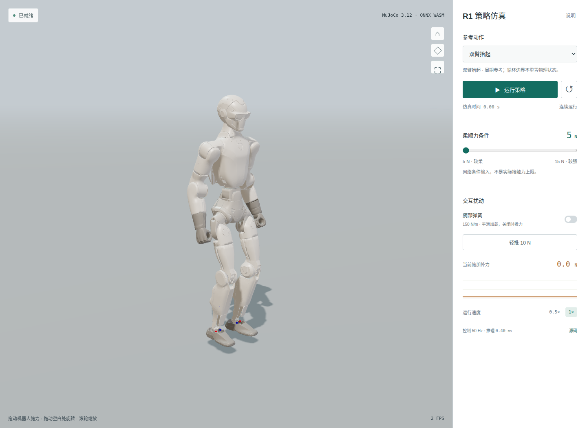

# Gentle R1 — 浏览器仿真

[打开网页演示](https://monkeypox966.github.io/gentle-r1-demo/) · [验证记录](docs/VALIDATION.md) · [资源来源](ASSET_PROVENANCE.json) · [致谢与许可](public/THIRD_PARTY_NOTICES.md)

R1 柔顺运动跟踪策略的纯浏览器闭环演示。MuJoCo 3.12 WASM 推进真实动力学，ONNX Runtime Web 执行已训练的冻结学生策略，Three.js 渲染当前仿真状态。无需 Python 服务、GPU 服务器、SSH 或串流客户端。



## 使用

建议使用桌面版 Chrome 或 Edge，等待模型与引擎加载后点击“运行策略”。资源未压缩体积约 50 MB，实际传输量随站点压缩和浏览器缓存而变。

- 可选择自然站立、双臂抬起、双臂前伸。参考周期为10秒，仿真持续运行，没有10秒停止限制；循环时不复位物理状态。
- 直接拖动机器人施力，拖动空白区域旋转视角，滚轮缩放。不需要Shift或切换施力模式；松开撤力。
- 运行中选择新动作会载入、复位并自动继续；加载失败时恢复真实生效的选项并显示错误。
- 可开启腕部弹簧，或点击“轻推 10 N”；箭头和曲线显示施加的外力。
- 5–15 N 滑块改变网络的柔顺力条件。它不是实际接触力的保证上限。
- 可查看参考叠影、暂停、复位和调整播放速度；隐藏标签页自动暂停。可持续运行至手动暂停或触发保护。

所有推理和物理计算均在访问者的浏览器中完成。50 Hz 是固定的仿真控制频率；性能不足时墙钟运行速度会降低，不跳过物理步，也不改变策略时间步。

## 冻结策略

| 项目 | 值 |
|---|---|
| 机器人 | Unitree R1，26 物理关节，24 策略动作 |
| 观测 | 392 维；归一化已封装在 ONNX 中 |
| 策略 / 目标滤波 / 动力学 | 50 Hz / 200 Hz / 1,000 Hz，位置执行器 |
| 头部 | PD 保持零位，不接收策略动作 |
| Checkpoint SHA256 | `61a5b331557f8e031de4f05fd71b48f58892e8d020578eaaeb1ea45f104af9c5` |
| ONNX SHA256 | `726ca9fd62520498125186e19a5fbc1d9e8d6607245852ca91cb167592d6df21` |

Teacher / Adapt / Finetune 的训练预算分别为 40 / 10 / 20 亿帧，实际完成 6,999,588,864 帧。该策略迁移自 GentleHumanoid 方法，不是原论文 G1 的严格复现。

网页参考动作是本项目自主生成的平滑目标轨迹，未打包 LAFAN、AMASS、InterX 或其他原始训练动作数据。机器人由策略与物理引擎控制，并非直接播放目标姿态动画。有限的浏览器演示不代替完整策略评估，亦不构成实机或人体接触验收。

网页仅保留三维视口与控制面板。相机默认固定在世界坐标，地面网格不跟随机器人。

脚底漂移排查见[接触诊断](docs/CONTACT_AUDIT.md)：保留摩擦系数1.0，细化网页接触积分并使用椭圆摩擦锥、NoSlip20。模型选项与原始部署包不同，有显式来源记录；原训练、冻结评估与权重未改动，也没有锁脚或外加位姿修正。

## 本地开发

需要 Node.js 24 LTS。构建只需要仓库内已导出的资源，不需要下载训练数据或安装 Python。

```bash
npm ci
npm test
npm run dev
```

使用终端显示的 `http://127.0.0.1:5173/gentle-r1-demo/` 地址。验证生产构建：

```bash
npm run build
npm run preview -- --port 4173
# 在另一个终端中：
npx playwright install chromium --only-shell
npm run test:browser
```

测试覆盖 Python 对照观测、动作滤波、冻结资产 SHA、浏览器 ONNX 数值对照、六组各22秒跨循环闭环、60秒WASM站立漂移、鼠标施力与视角分离、移动布局。浏览器测试使用软件 WebGL，无需 NVIDIA GPU。

本项目服务器上的计算请使用 `bash scripts/resource.sh <命令>`，它排除 CPU1、限制内存并持有全局仿真锁。其他机器可直接使用 npm 命令；不要照搬本机绝对路径。`scripts/export-assets.py` 仅供从本机冻结部署包重新导出，不参与网页或 GitHub Actions 构建。

## 结构与发布

```text
src/control.js         观测、四种关节顺序映射、滤波、关节/姿态保护
src/simulation.js      ONNX 推理、MuJoCo 闭环、弹簧与交互外力
src/viewer.js          当前物理状态渲染、参考叠影、鼠标拾取施力
src/main.js            UI 与不重入的异步控制循环
public/assets/r1/      冻结 ONNX、MuJoCo XML/mesh、自主生成的参考
public/licenses/       第三方许可证与通知
tests/                 Python 导出的数值对照与真实浏览器验收
docs/                  精简验证记录与实际截图
```

推送 `main` 的代码或资源更新后，GitHub Actions 自动执行单元测试、构建与真实浏览器验收，全部通过后发布 GitHub Pages。仅更新README、AGENTS或docs不会重新部署。发布器使用官方Pages API及OIDC授权，最长等待25分钟；只有确认成功才标记发布完成，失败/取消时清理本次部署。WASM 使用单线程，不依赖 GitHub Pages 无法自定义的跨源隔离响应头。所有运行资源同源托管，没有 CDN 运行依赖。

修改仓库名时必须同步 `vite.config.js` 的 `base`、测试地址及文档链接。训练代码、数据与历史记录仍在独立的 `gentle-r1` 项目中；本仓库不会启动或改变训练。

## 来源

[GentleHumanoid](https://gentle-humanoid.axell.top/) 提供研究方法；[humanoid-policy-viewer](https://github.com/Axellwppr/humanoid-policy-viewer) 和 [mujoco_wasm](https://github.com/zalo/mujoco_wasm/) 提供网页交互与渲染参考。R1 控制层依据本项目的 Python 部署契约重新实现。使用官方 MuJoCo、ONNX Runtime Web、Three.js 与 Unitree 模型；详见第三方许可。

动作切换修正与真实手臂运动证据见[修正记录](docs/MOTION_SWITCH_FIX.md)。旧测试只检查仿真存活，不能证明动作切换；现要求实际动作ID、策略输入和双臂关节运动均匹配，并覆盖加载失败与乱序返回。
